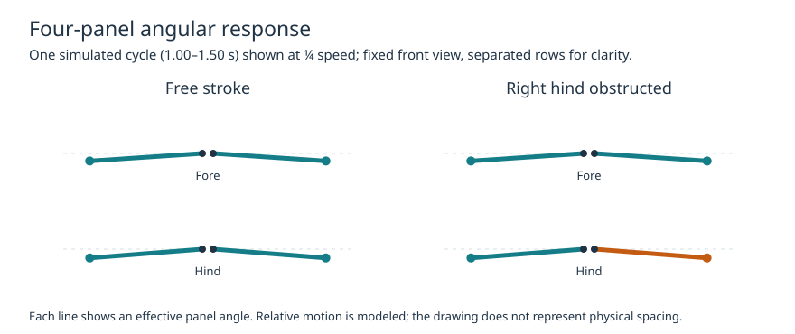
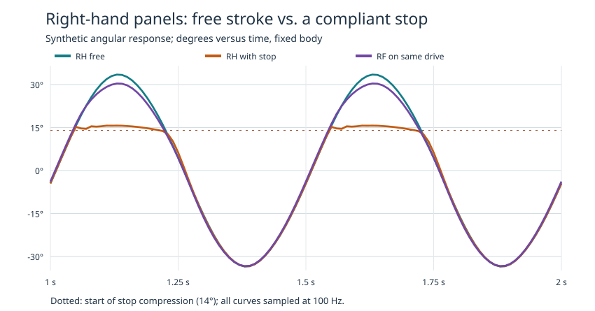

# 四片翼动态演示 · 2026-11-18

同侧前后翼共用驱动，其中一片遇阻时，两片的反应不同。在这组合成参数下，右后翼正常扑动的正向峰值为 33.48°；人为设置在 14° 开始压缩的弹性挡块后，正向峰值降至 15.67°。同侧右前翼仍在运动。这个对照演示如何识别单片翼受阻，不能用来判定实体机构是否会碰撞。



慢放取 1.00–1.50 s 的一个周期，播放时间 2 s。前、后两行分别显示各片翼的等效角度，图上的距离仅用于排版。如果预览不播放，可下载 [SVG](four-panel-motion.svg) 用浏览器打开，或直接看下面的曲线。



## 原始数据与结果

[完整时间序列 CSV](trace.csv) 共 1,505 行数据，5 组各 3 s，100 Hz 采样。角度单位为 °，力矩为 N·m，能量/净机械功为 J。正向峰值与半摆幅分别表示 1 ≤ t < 2 s 样本的最大值和（最大值 − 最小值）/2。峰值为采样值。下表四个角度均为半摆幅。

| 合成指令 / 扰动 | 左前 | 左后 | 右前 | 右后 |
|---|---:|---:|---:|---:|
| 左右目标均为 32° | 33.42° | 33.48° | 33.42° | 33.48° |
| 左 22°、右 36° | 22.96° | 23.00° | 37.60° | 37.67° |
| 左 36°、右 22° | 37.60° | 37.67° | 22.96° | 23.00° |
| 仅右后翼加挡块，左右目标 32° | 33.42° | 33.48° | 31.87° | 24.55° |
| 2 s 撤销驱动（此列角度取撤销前） | 33.42° | 33.48° | 33.42° | 33.48° |

遇阻时右后翼在负向仍可运动，所以半摆幅 24.55° 大于其正向峰值 15.67°。挡块只在压缩区施加反向力矩，模型最大采样接触力矩为 0.03216 N·m。断开驱动时，左右驱动力矩同时变为零，已有动能和弹性势能仍可使翼片继续运动；总储能从 2 s 时的 4.196 mJ 衰减至 3 s 时的 2.16 × 10⁻⁸ mJ。[全部指标与参数](summary.json)

## 模型与复现

每侧一个有惯量的翼根和前、后两个有惯量的翼片，共六个转动自由度。面板有效角与翼根之差代表一阶弯曲，不代表额外安装了两个铰链。弹性连接力矩为 `k(根角−片角)+c(根角速度−片角速度)`，该力矩以相反符号作用于翼根和翼片。面板受与角速度相关的一次和二次阻力；驱动按位置误差和翼根角速度计算力矩并限幅。合成指令频率 2 Hz，前 0.5 s 平滑起振。所有常数在 [脚本](../../four_panel_demo.py) 与 [JSON](summary.json) 中给出，内部使用 SI 单位和弧度。挡块为人为施加的单向弹簧，压入阶段另有黏性阻尼。该固定机身模型不计算升力、航迹、充电、耗电、射频或自动失联检测。机械净功不是电池耗电量。

使用 Python 3.9+ 标准库，在仓库根目录运行：

```sh
python3 -B -m unittest discover -v
python3 -B four_panel_demo.py --output output/four-panel-demo
```

公开数据使用固定步长四阶 Runge–Kutta，步长 0.5 ms。对同一输出时刻比较 1.0 ms 与 0.5 ms 两次计算，五组、六个角度中最大差 0.02364°（遇阻情景）。最大绝对机械能收支残差为 6.64 × 10⁻⁷ J 以内。步长比较只检验数值变化，未标定合成弹性、阻力或驱动力矩。独立复跑产生相同的 CSV、JSON 和图像字节。

[测试源码](../../test_four_panel_demo.py) 和 [测试日志](test-log.txt) 包含本轮 6 项动力学检查及 22 项原混控测试。新检查包括无外力匀速解析解、左右镜像、单侧接触与同侧传载、撤驱后的耗散、功与能量平衡、步长减半。实物对照应同步记录左右前后四片的角度、机构间隙和电流；不能直接套用本例的挡块阈值或力矩。
